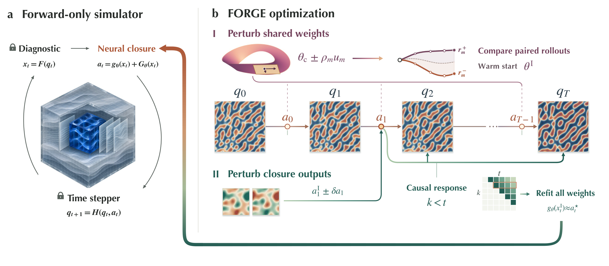
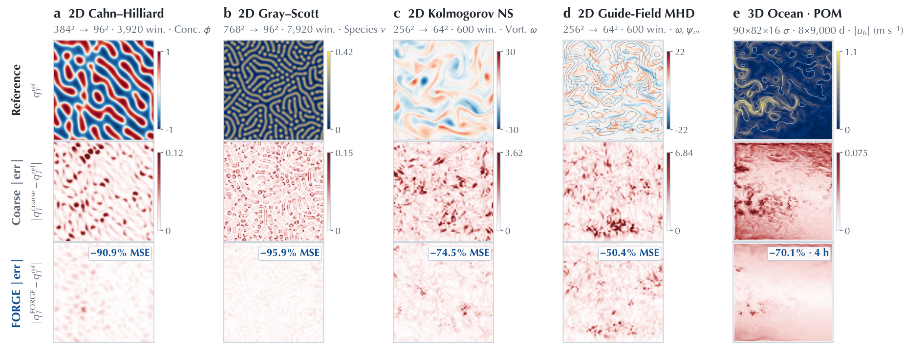

<h1 align="center">🔭 Sounding the Black Box: Online Training of Embedded Neural Networks in Forward-Only Physical Simulators</h1>

<p align="center">
  <b>Official implementation of FORGE (Forward-Only Response and Gauss–Newton Estimation)</b>
</p>

<p align="center">
  <b>Ruiqi Shu</b><sup>1,*</sup> ·
  <b>Tianrun Gao</b><sup>2,*</sup> ·
  <b>Haomin Wen</b><sup>3,&dagger;</sup> ·
  <b>Xiaomeng Huang</b><sup>1,&dagger;</sup>
</p>

<p align="center">
  <sup>1</sup>Department of Earth System Science, Tsinghua University ·
  <sup>2</sup>School of Computing and Data Science, The University of Hong Kong ·
  <sup>3</sup>Shanghai Innovation Institute
</p>

<p align="center">
  <sup>*</sup>Equal contribution ·
  <sup>&dagger;</sup>Correspondence: Haomin Wen (<code>wenhaomin.whm@gmail.com</code>), Xiaomeng Huang (<code>hxm@tsinghua.edu.cn</code>)
</p>

<div align="center">

[](https://arxiv.org/abs/2611.31964)
[](https://arxiv.org/pdf/2611.31964)
[](https://www.python.org/)
[](https://pytorch.org/)
[](LICENSE)
[](https://github.com/ChiyodaMomo01/FORGE)

</div>

<div align="center">
  
</div>

## Abstract

Hybrid physics–neural simulators embed neural networks in partial differential equation (PDE) solvers to model unresolved subgrid dynamics while preserving resolved physics and conservation laws. Because closure outputs feed back across time steps, single-step offline regression does not directly minimize multi-step rollout error, motivating online trajectory optimization. Solver backpropagation through time (`Solver BPTT`) is the standard online solution when solver derivatives are available, yet many operational Fortran and C/C++ simulators expose only non-differentiable, forward-only interfaces.

**FORGE** (**F**orward-**O**nly **R**esponse and **G**auss–**N**ewton **E**stimation) is an online framework that trains embedded neural closures from forward runs alone by decoupling exact network derivatives from black-box simulator dynamics:

- **Stage I (Parameter-space warm-up):** probes a low-dimensional joint readout–backbone weight subspace (output-tangent orthonormalized via forward-mode network Jacobians in 2D; QR-orthonormalized in parameter space in 3D), applies truncated-SVD readout drift compensation on cached output tangents to cancel nonlinear trunk drift, and performs a curvature-damped Gauss–Newton warm-up accepted by actual rollout loss.
- **Stage II (Causal output-response update):** perturbs spatial closure outputs around the warmed-up trajectory to fit a gain-bounded causal linear response operator $\mathcal{R}$ across rollout steps, solves a regularized normal equation via trust-region conjugate gradients for step-wise target outputs, and updates all network weights via standard backpropagation through the neural closure alone ($H^2$ Sobolev variable projection in 2D; replay-weighted optimization through $\mathcal{R}$ and causal observation-shift blocks $K_{\text{obs}}$ in 3D).

Across five 2D and 3D benchmarks spanning phase separation, reaction–diffusion, fluid and MHD turbulence, and 3D free-surface ocean circulation, FORGE cuts coarse-solver test MSE by **50%–96%** in 2D and **70%** in 3D, outperforms the strongest forward-only baseline by **16%–69%**, matches its final accuracy using **42%–80%** fewer rollouts, recovers **88%–98%** of `Solver BPTT`'s gains, and remains stable up to **8x–12x** the training horizon.

## Overview

Let $q_t$ be the coarse solver state, $x_t = F(q_t)$ the public closure observation, and $a_t = g_0(x_t) + G_\theta(x_t)$ the executed closure action advancing $q_{t+1} = H(q_t, a_t)$, where $\theta = (h, b)$ splits the linear readout $h$ and hidden backbone $b$. Within each benchmark, all methods start from the same frozen checkpoint $\theta_0$ (`common.pt` in 2D; `common_zero.pt` in 3D POM): **2D Gray-Scott**, **2D Kolmogorov NS**, **2D Guide-Field MHD**, and **3D POM** initialize from zero-output cold start ($h_0 = 0$, $G_{\theta_0} \equiv 0$), whereas **2D Cahn-Hilliard** canonically initializes from a shared offline pair-supervised checkpoint ($h_0 \neq 0$, fitted without solver derivatives; cold start $h_0 = 0$ is also supported).

Automatic differentiation inside FORGE and all forward-only baselines operates strictly on learner-owned networks and fitted response operators (with 2D physical solvers isolated behind an OS subprocess pipe and 3D POM executed with autograd disabled). Only the white-box `Solver BPTT` (`AD`) reference differentiates through the physical time integrator.

This repository provides unified implementations of:

- **Two-stage FORGE and single-factor ablations**: 2D periodic (`src/forge/`) and 3D bounded-basin ocean (`src/forge_pom3d/`)
- **Six forward-only baseline families**: `ES`, `EKI`, `Global PPO`, `Local PPO`, `Closure-RL`, and the `Neural Emulator Method`
- **White-box oracle reference**: converged `Solver BPTT` (`AD`) across all five benchmarks
- **Self-contained PDE solvers**: four periodic 2D PDE integrators (`src/forge/cases/`) and a semi-implicit 3D primitive-equation ocean dynamical core (`src/forge_pom3d/ocean/`)

For detailed design notes, see [Architecture](docs/ARCHITECTURE.md), [Benchmarks](docs/BENCHMARKS.md), and [Reproducibility](docs/REPRODUCIBILITY.md).

## Five-Scenario Hybrid Solver Benchmark

<div align="center">
  
</div>

Parent trajectories in every scenario are partitioned into disjoint **training**, **validation**, and **test** splits prior to window extraction:

| Benchmark | Domain | Reference $\to$ Coarse | Coarse Numerical Solver ($H$) | $(F, G_\theta)$ Ch. | Network $G_\theta$ ($p$) | Callbacks / Win. | Train / Val / Test Windows |
| --- | --- | --- | --- | --- | --- | --- | --- |
| **2D Cahn-Hilliard** | $[0, 1.0)^2$ | $384^2 \to 96^2$ ($4\times$ avg.) | Stabilized IMEX Fourier Euler | $2 \to 1$ | 4-layer Periodic FNO (`489,057`) | `100` | `2,352` / `784` / `784` |
| **2D Gray-Scott** | $[0, 2.5)^2$ | $768^2 \to 96^2$ ($8\times$ avg.) | Strang exact diff. + midpoint react. | $4 \to 1$ | 4-layer Periodic FNO (`489,057`) | `480` | `4,752` / `1,584` / `1,584` |
| **2D Kolmogorov NS** | $[0, 2\pi)^2$ | $256^2 \to 64^2$ (spec. trunc.) | 4-stage Cox-Matthews ETD-RK4 | $6 \to 2$ | Full-spec. Periodic FNO (`490,027`) | `160` | `360` / `120` / `120` |
| **2D Guide-Field MHD** | $[0, 2\pi)^2$ | $256^2 \to 64^2$ (spec. trunc.) | Coupled $2\times 2$ matrix ETD-RK4 | $8 \to 3$ | Full-spec. Periodic FNO (`490,057`) | `160` | `360` / `120` / `120` |
| **3D Ocean Model (POM)** | $0^\circ\text{--}22^\circ\text{E}, 30^\circ\text{--}50^\circ\text{N}$ | $354\times 322\times 16\sigma \to 90\times 82\times 16\sigma$ ($4\times$ avg.) | Semi-implicit Helmholtz CG + Thomas + RA | $161 \to 60$ | 8-block Dilated ResNet (`4,271,172`) | `4` (24 3D steps) | `1,800` / `16` / `48` (4h + `1-48h`) |

## Key Results

Closed-loop test trajectory MSE across all five benchmarks (change relative to unparameterized Coarse Physics in parentheses):

| Method | 2D Cahn-Hilliard ($\times 10^{-5}$) | 2D Gray-Scott ($\times 10^{-3}$) | 2D Kolmogorov NS ($\times 10^{-3}$) | 2D Guide-Field MHD ($\times 10^{-2}$) | 3D POM (4h Test) |
| --- | :---: | :---: | :---: | :---: | :---: |
| Coarse Physics ($G_\theta \equiv 0$) | `45.2` | `125.8` | `17.07` | `6.81` | `1.159` |
| Best Forward-Only Baseline | `10.3` (`-77.3%`, EKI) | `16.7` (`-86.7%`, EKI) | `6.80` (`-60.2%`, EKI) | `4.01` (`-41.0%`, EKI) | `0.614` (`-47.0%`, Emulator) |
| **FORGE (Ours)** | **`4.1` (`-90.9%`)** | **`5.2` (`-95.9%`)** | **`4.35` (`-74.5%`)** | **`3.38` (`-50.4%`)** | **`0.347` (`-70.1%`)** |
| *Solver BPTT (White-Box Oracle)* | *`2.91` (`97.1%` rec.)* | *`1.01` (`96.6%` rec.)* | *`2.97` (`90.2%` rec.)* | *`2.90` (`87.7%` rec.)* | *`0.332` (`98.2%` rec.)* |

## Requirements

- Python `3.10+`
- PyTorch `2.4+` with `torch.distributed` (CUDA/NCCL for multi-GPU DDP training)
- NumPy `>=1.24`
- Optional for 3D POM: `netCDF4 >= 1.6` (and `triton >= 2.2` on Linux)

Install in editable mode and run static lint/format verification:

```bash
git clone https://github.com/ChiyodaMomo01/FORGE.git
cd FORGE

python -m pip install -e '.[dev,pom3d]'
python -m ruff check --no-cache src scripts
python -m ruff format --check --no-cache src scripts
```

## Environment & Data Path Configuration

Data and output locations are supplied explicitly via CLI flags or environment variables (precedence: **CLI flags > environment variables > JSON profile > recipe defaults**):

| Variable | Used by | Description |
| --- | --- | --- |
| `FORGE_CASE` | 2D training & prep | Benchmark name (`cahn_hilliard`, `gray_scott`, `kolmogorov_ns`, `mhd2d`) |
| `FORGE_ORIGINAL_ROOT` | 2D data & training | Root directory of coarse-grained 2D reference trajectories |
| `FORGE_PAIRS_ROOT` | 2D data & training | Root directory of 2D offline replay pairs |
| `FORGE_REFERENCE_ROOT` | 2D DDP runs | Verified reference suite directory containing frozen `common.pt` and manifest |
| `FORGE_OUTPUT_ROOT` | 2D training | Output root directory for checkpoints and metrics |
| `FORGE_POM3D_DATASET_ROOT` | 3D POM | Pre-generated 3D double-gyre dataset directory (including `manifest.json`) |
| `FORGE_POM3D_OUTPUT_ROOT` | 3D POM | Output root directory for 3D POM checkpoints and rollout evaluations |

## Quick Start

### 2D Benchmarks

This repository includes full end-to-end 2D reference data generation (`scripts/produce_2d_benchmarks.py`; see [Reproducibility](docs/REPRODUCIBILITY.md)). Once reference data are ready, prepare the window manifest and freeze the shared starting checkpoint (`common.pt`):

**Zero-output cold start** (`gray_scott`, `kolmogorov_ns`, `mhd2d`):

```bash
export FORGE_CASE=gray_scott
export FORGE_ORIGINAL_ROOT=/path/to/original
export FORGE_PAIRS_ROOT=/path/to/pairs
export FORGE_OUTPUT_ROOT=/path/to/gray_scott_suite

for stage in prepare physics_start pure_physics common validate_gate; do
  python -m forge.run --case "$FORGE_CASE" --method "$stage" --device cpu
done
```

**Offline pair-supervised initialization** (canonical `cahn_hilliard`, $h_0 \neq 0$):

```bash
export FORGE_CASE=cahn_hilliard
export FORGE_ORIGINAL_ROOT=/path/to/original
export FORGE_PAIRS_ROOT=/path/to/pairs
export FORGE_OUTPUT_ROOT=/path/to/cahn_hilliard_suite

python -m forge.run --case "$FORGE_CASE" --method prepare --device cpu
python -m forge.run --case "$FORGE_CASE" --method pretrain --device cuda:0
for stage in freeze_common pure_physics common validate_gate; do
  python -m forge.run --case "$FORGE_CASE" --method "$stage" --device cpu
done
```

**Launch distributed two-stage FORGE and evaluate on held-out test windows**:

```bash
export FORGE_REFERENCE_ROOT="$FORGE_OUTPUT_ROOT"
export FORGE_OUTPUT_ROOT=/path/to/forge_main_run
FORGE_METHOD=main NPROC_PER_NODE=8 bash scripts/train_2d_ddp.sh

python scripts/eval_2d_test_id.py \
  --case "$FORGE_CASE" --reference-root "$FORGE_REFERENCE_ROOT" \
  --checkpoint "$FORGE_OUTPUT_ROOT/main/selected.pt" \
  --output-json "$FORGE_OUTPUT_ROOT/test_id_eval.json" --device cuda --world-size 8
```

### 3D Ocean Circulation (POM)

This repository provides the full source code without pre-generated 3D datasets or trained checkpoints; supply a pre-generated double-gyre dataset directory (including `manifest.json`) via `FORGE_POM3D_DATASET_ROOT`.

The **`pure_4h`** protocol optimizes 4-hour closed-loop ocean trajectories from the shared zero-output network (`common_zero.pt`) and evaluates frozen checkpoints on all **48** held-out test trajectories across **1–48 hours** ([Configuration](configs/pom3d_pure4h.json), [Evaluator](scripts/eval_pom3d_rollout.py)):

```bash
export FORGE_POM3D_DATASET_ROOT=/path/to/pom3d_dataset
export FORGE_POM3D_OUTPUT_ROOT=/path/to/pom3d_run
FORGE_POM3D_STAGE=forge_main NPROC_PER_NODE=8 bash scripts/train_pom3d_ddp.sh

python scripts/eval_pom3d_rollout.py \
  --checkpoint "$FORGE_POM3D_OUTPUT_ROOT/stage2_forge_main/best_model.pt" \
  --dataset-root "$FORGE_POM3D_DATASET_ROOT" \
  --hours 1 2 4 24 48 --split test --device cuda:0 \
  --output-json "$FORGE_POM3D_OUTPUT_ROOT/rollout_test.json"
```

Full baseline commands, single-factor ablations, `Solver BPTT` (`AD`) runs, and 2D dataset generation instructions are documented in [Reproducibility](docs/REPRODUCIBILITY.md).

## Repository Structure

```text
FORGE/
|-- assets/                  # Overview and five-benchmark figures
|-- configs/                 # 2D benchmark/production configs and 3D POM pure_4h profile
|-- docs/                    # ARCHITECTURE.md, BENCHMARKS.md, REPRODUCIBILITY.md
|-- scripts/                 # 2D data generation, DDP training launchers, and test evaluators
|-- src/
|   |-- forge/               # 2D PDE cases, process-isolated runtime, two-stage FORGE, baselines, AD
|   `-- forge_pom3d/         # 3D POM two-stage FORGE, baselines, AD, and semi-implicit ocean core
|-- pyproject.toml           # Package metadata and CLI entrypoints (forge-2d, forge-pom3d)
|-- MANIFEST.in              # Source distribution manifest
|-- LICENSE                  # Apache License 2.0
`-- README.md
```

## License

Licensed under the [Apache License 2.0](LICENSE).

## Citation

If you find FORGE useful in your research, please cite:

```bibtex
@article{shu2026forge,
  title={Sounding the Black Box: Online Training of Embedded Neural Networks in Forward-Only Physical Simulators},
  author={Shu, Ruiqi and Gao, Tianrun and Wen, Haomin and Huang, Xiaomeng},
  journal={arXiv preprint arXiv:2611.31964},
  year={2026},
  url={https://arxiv.org/abs/2611.31964}
}
```
